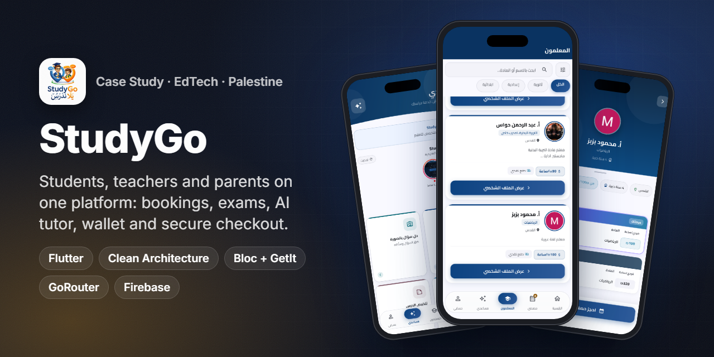
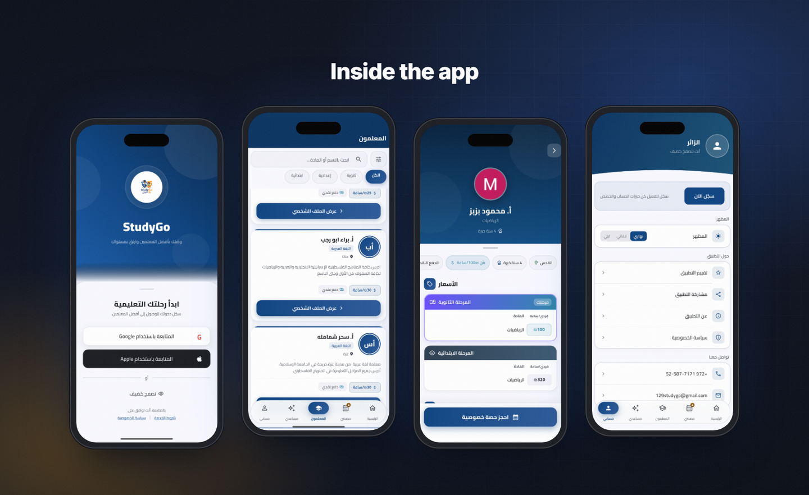
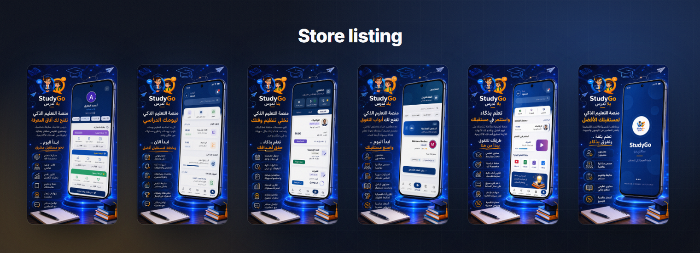
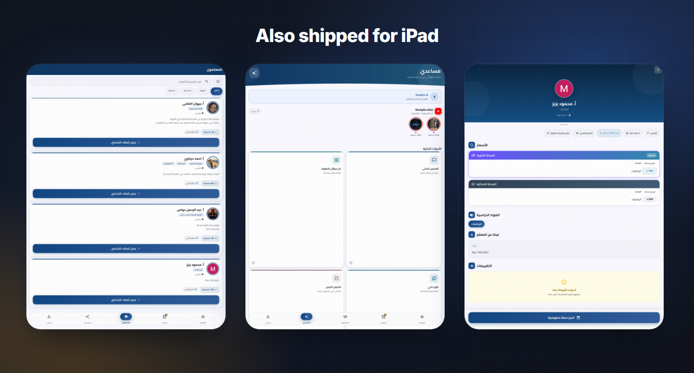
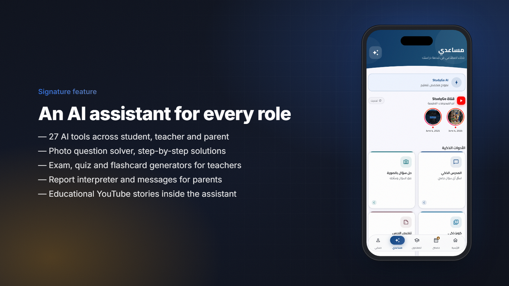
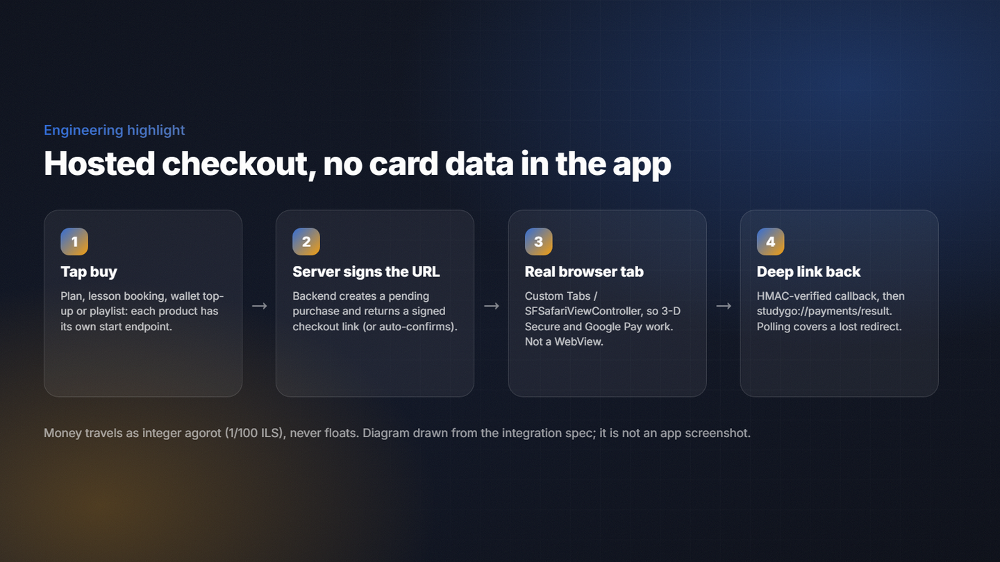
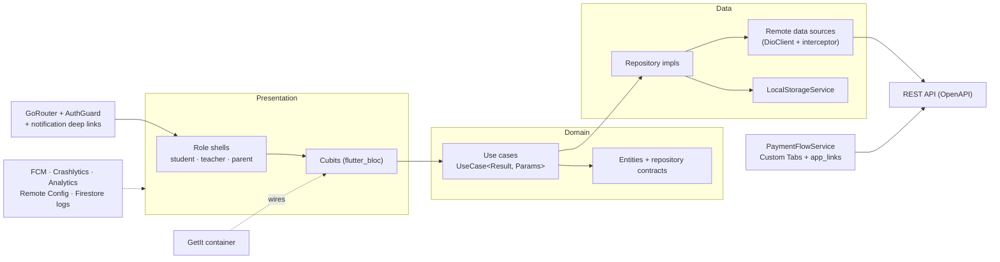

<h1 align="center">StudyGo (ستادي جو)</h1>

<b>One education app for students, teachers and parents in Palestine: find a teacher, book and pay for lessons, sit exams, and learn with an AI assistant.</b>

  
  
  
  
  
  
  
  
  

> ℹ️ This is a case study. The source code belongs to the client and is not included.

## Overview

**StudyGo** connects students in Jerusalem and across Palestine with specialised teachers for the **Tawjihi** and **Bagrut** (Arabic) curricula, including the 3–5 unit tracks. It is one app with three roles:

- **Students** find teachers, book private or group lessons, buy study programs, sit exams and use an AI study assistant.
- **Teachers** go through an activation wizard. Then they manage subjects, sessions, files, exams and grading, and see their earnings, wallet and subscription.
- **Parents** link their children, follow sessions and exam results, and get AI help to read reports and write to teachers.

**My role was the full Flutter app.** That covered the architecture, every screen for all three roles, payments, notifications, the AI features and the store releases for Android, iPhone and iPad. The backend and its REST/OpenAPI contract were built by the client's backend team. I integrated against it.

The project started in April 2026, and the App Store release came in July 2026. The current version at the time of writing is 1.0.3.

## The challenge

- **Three products in one app.** Students, teachers and parents have different home screens, tabs and permissions. A teacher can also be pending review, and users can switch roles.
- **Real money, real compliance.** Lessons, plans, wallet top-ups and program purchases are paid by card through a hosted payment page. 3-D Secure and Google Pay don't run inside a WebView, and money must never be a floating-point number.
- **Timed exams on untrusted clocks.** A student's phone clock can be wrong. Exam countdowns have to follow the server.
- **Store rules.** There is no login wall (Apple 5.1.1(v)), Sign in with Apple must sit next to Google, in-app account deletion is required, and guests must be able to browse.

## Highlights

**🎓 Students**
- Browse and filter teachers by stage (primary, middle, secondary). Profiles show prices, experience, location and reviews.
- Book private sessions or join group sessions. Online sessions carry a per-session meeting link.
- A store of study programs (playlists) with purchases, a "my purchases" section, and a timeline of sessions.
- Exams: sit timed papers, review attempts and see published results.

**👩‍🏫 Teachers**
- An activation wizard with a progress card. The app has pending, awaiting-review, approved and rejected states.
- Subjects, sessions, files (PDF and video viewers), exams and a **grading queue**. Objective questions are scored automatically. Results stay hidden until the teacher publishes them.
- Earnings, bank account and payout day, a recurring subscription panel, and a **wallet** for cash-commission top-ups.

**👨‍👩‍👧 Parents**
- Link children and see each child's sessions and progress, with AI help to interpret reports and draft messages to teachers.

**🤖 AI and content**
- **27 AI tools** across the three roles:
  - photo question solver and step-by-step solver
  - summaries and flashcards
  - study plans and a Tawjihi review
  - essay grading and a writing trainer
  - exam, quiz and question-bank generators
  - lesson plans
  - report interpreter and parent/teacher messages
  - and more
- An educational **YouTube stories** row. Stream URLs are resolved natively, so playback needs no WebView.

**🔔 Platform**
- FCM push plus a REST notification feed with deep-link routing. Device tokens are registered on login and removed on logout.
- Guest mode with contextual sign-up sheets, Google and Apple native sign-in, and in-app account deletion.
- Remote Config force update, Crashlytics, Analytics with 25+ events, and Firestore logging of critical errors.

## Screens

Welcome with Google/Apple sign-in, teacher list, teacher profile with prices, and the guest account screen.

Google Play marketing screenshots: profile, daily schedule, sessions, teachers, home and splash.

The same app on iPad (App Store iPad screenshots).

> All screenshots come from the public Google Play and App Store listings. The teacher names shown are public teacher profiles on the platform.

## Signature feature: an AI assistant for every role

The assistant tab is the same entry point for everyone, but the tools change with the role:

- **Students:** solve a question from a photo, step-by-step solutions, explain a curriculum topic, summarise a lesson, flashcards, a study plan, a quick self-assessment, a Tawjihi review and a writing trainer.
- **Teachers:** generate an exam, a quiz or a question bank, build a lesson plan, grade essays, design adaptive activities, improve an explanation, compare concepts and issue a certificate.
- **Parents:** interpret a report, get home-support ideas and motivation tips, and draft a message to the teacher.

Each tool is its own page in the `users_ai` feature, with data, domain and presentation layers. Above the tools sits a **StudyGo channel**: YouTube stories played in-app through `youtube_explode_dart` and `video_player`.

## Payments: hosted checkout with no card data in the app

Every paid product (plan upgrade, lesson booking, group-session pay-now, wallet top-up, program purchase) has its own "start" endpoint, but all of them return the same shape: `{ mode, redirectUrl?, purchaseId? }`.

- `mode: checkout` → the app opens the URL in a **real browser tab** (`flutter_custom_tabs`). Then it waits for the deep link `studygo://payments/result?status=…&purchaseId=…`, which `app_links` catches. A `PaymentFlowService` parses it and shows the right result screen.
- `mode: auto_confirm` → the server has already activated the product, so the app goes straight to success.
- **Lost redirect?** If the user closes the tab, the app polls the purchase status as a fallback.
- All amounts are signed integers in **agorot** (1/100 ILS) on the wire and are formatted only at the edge.

## Architecture & stack

| Layer | Technology |
|---|---|
| Architecture | Clean Architecture, feature-first: `features/<x>/{data,domain,presentation}`, `core/`, `shared/`, `di/` |
| State | `flutter_bloc` 9 + `equatable`; sealed states |
| DI | `get_it` |
| Routing | `go_router` with an auth guard, role-based shells and notification deep links |
| Errors | `dartz` `Either` and typed `Failure` classes mapped from HTTP codes (Arabic messages) |
| Networking | Single `DioClient`, a bearer-token interceptor and `connectivity_plus` |
| Payments | `flutter_custom_tabs` + `app_links` (deep link `studygo://`) |
| Media | `video_player` + `chewie`, `flutter_pdfview`, `youtube_explode_dart`, `cached_network_image` |
| Maps | `flutter_map` + OpenStreetMap, `geolocator` |
| Auth | `google_sign_in`, `sign_in_with_apple` (native ID-token flow) |
| Firebase | Messaging, Crashlytics, Analytics, Remote Config, Cloud Firestore; `flutter_local_notifications` |
| Design | "Academic Curator" design system: Academic Blue `#0C4381` and Progress Orange, Manrope / Cairo / Inter fonts |

## Engineering notes

- **The exam clock never trusts the device.** The countdown reads the offset the server returns with the attempt and re-anchors on every save. A phone that is ten minutes fast still shows the true remaining time. Saving an answer rebuilds the paper, but the question being typed into does not re-animate. The pinned header turns red in the last five minutes.
- **Grading that respects the teacher.** Objective answers arrive pre-scored. The grading queue only holds human-marked questions and the final confirmation. Students and parents see nothing until the teacher publishes.
- **A browser tab, not a WebView, for payments.** 3-D Secure challenges and Google Pay refuse to run inside WebViews. A Custom Tab (Android) or Safari view (iOS) plus a deep-link return keeps card data out of the app and passes store review.
- **Guest mode by design.** A guest is just a logged-out app: no token and no server state. Public endpoints are called without an `Authorization` header. Any gated action ("book with…", "save this list", "link your child") opens a contextual Google/Apple sign-up sheet over the current screen.
- **Notifications that land in the right place.** Each notification kind maps to a deep link. One router handles taps from both FCM pushes and the in-app feed. Token refreshes are re-registered automatically.
- **Fault-tolerant startup.** Firebase initialisation is wrapped so a misconfigured service can't crash launch. Analytics calls go through a `_safe()` guard. Critical errors are also written to Firestore for triage.

## Results

- **Live on Google Play** ([com.study.go](https://play.google.com/store/apps/details?id=com.study.go)) with **100+ installs**.
- **Live on the App Store** ([Study Go](https://apps.apple.com/sa/app/study-go/id6777997182)) in the Education category, version 1.0.3, for iPhone and iPad.

## بالعربي

**ستادي جو** منصة تعليمية تربط طلاب القدس والمدن الفلسطينية بمعلمين متخصصين في التوجيهي والبجروت، داخل تطبيق واحد بثلاث واجهات: طالب ومعلم وولي أمر.
فيها حجز حصص خاصة وجماعية، ومتجر برامج دراسية، وامتحانات بمؤقت مرتبط بالخادم مع تصحيح يعتمده المعلم، ومحفظة وأرباح للمعلم.
وفيها 27 أداة ذكاء اصطناعي حسب الدور، وقصص يوتيوب تعليمية داخل التطبيق.
الدفع يتم عبر صفحة دفع مستضافة في متصفح حقيقي، ثم يعود المستخدم للتطبيق عبر رابط عميق. التطبيق مبني بـ Clean Architecture وBloc وGetIt وGoRouter، ومنشور على Google Play وApp Store.

## Links

- ▶️ [Google Play](https://play.google.com/store/apps/details?id=com.study.go)
- 🍎 [App Store](https://apps.apple.com/sa/app/study-go/id6777997182)

---
<h3 align="center">Built by Mahmoud Shaker — Senior Flutter Engineer</h3>

  
  
  
  
  
  
  

